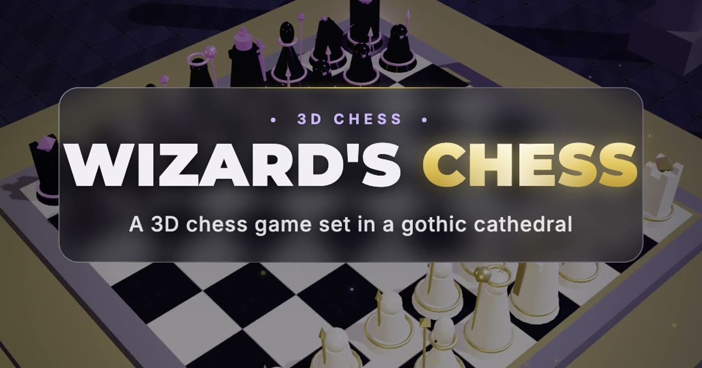

<div align="center">


# Wizard's Chess

### 3D chess in a gothic cathedral, where the pieces fight back

Pieces march across the board, strike their target and shatter it into shards.
Full chess rules, an AI opponent and pass & play, all in a single HTML file.

<a href="https://zain-chess.netlify.app/"></a>

<br/><br/>


<br/>

<a href="https://zain-chess.netlify.app/"></a>

</div>

---

## ✨ Features

| | |
|---|---|
| ⚔️ **Battle animations** | Captures play out as an attack: the piece moves in, strikes, and the victim shatters into physics-driven shards. |
| ♟️ **Full chess rules** | Castling, en passant, promotion (with a piece picker), check, checkmate, stalemate and draws, validated by `chess.js`. |
| 🧙 **Archmage AI** | Alpha-beta search with iterative deepening (up to depth 4), quiescence search and move ordering, on a 300 ms budget so the frame rate never stalls. |
| 👥 **Pass & play** | Toggle to local two-player mode and hand the device across the table. |
| 🪄 **Wizard Strike** | Stuck? Let the AI play the best move for you. |
| 🏰 **Gothic cathedral** | Procedurally generated marble, obsidian and cathedral-floor textures, a sanctuary dais and atmospheric lighting. No image assets. |
| 🎥 **Five camera views** | White, Black, Cathedral Nave, Cathedral Side and Sanctuary Top, plus free orbit and zoom. |
| 📜 **Battle Chronicle** | Move log, captured pieces and material advantage in a slide-out drawer. |
| 🔊 **Synthesised sound** | Stone thuds, metallic shatters and a choir, generated live with Tone.js. |
| 📱 **Works on mobile** | Touch to select, drag to orbit, pinch to zoom. |

## 🎮 How to play

1. Open **[zain-chess.netlify.app](https://zain-chess.netlify.app/)**. Nothing to install.
2. Click or tap a piece to see its legal moves highlighted, then click a target square.
3. You play **White** against the Archmage AI by default. Use the control bar to switch modes.

### Controls

| Action | Mouse | Touch |
|---|---|---|
| Select / move a piece | Click | Tap |
| Orbit the camera | Drag | Drag |
| Zoom | Scroll wheel | Pinch |

### Control bar

| Button | What it does |
|---|---|
| 🎥 **View** | Cycle through the five camera presets |
| 🤖 **vs. Archmage AI** | Switch between the AI opponent and 2-player pass & play |
| 🪄 **Wizard Strike** | Let the AI make the best move for your side |
| 📜 **Chronicle** | Open the move log and shattered-pieces drawer |
| 🔊 **Sound** | Mute or unmute the cathedral acoustics |
| 🔄 **Reset** | Start a new game |

## 🚀 Run locally

The whole game is one self-contained `index.html`. Libraries load from CDNs, so there's no build step and no `npm install`.

```bash
git clone https://github.com/zainulabdn/Chess-Game.git
cd Chess-Game
python3 -m http.server 8000
```

Then open **http://localhost:8000**. Opening `index.html` directly also works, but a local server is closer to how it's hosted.

## 🧠 Under the hood

```
index.html
├── Three.js scene     → cathedral, board, procedural textures, lighting
├── Piece builder      → wizard-style meshes for every piece type
├── Animation engine   → move arcs, attack strikes, shatter particles
├── chess.js           → move legality and game state
├── Archmage AI        → minimax + alpha-beta, iterative deepening, quiescence
├── Tone.js audio      → membrane, metal and choir synths
└── MD3 + Tailwind UI  → control bar, chronicle drawer, modals
```

**AI details**

- Material evaluation (`P 100 · N 320 · B 330 · R 500 · Q 900`) plus a centre-control bonus
- Iterative deepening to depth 4 with a hard 300 ms deadline; a timeout keeps the last completed depth
- Quiescence search on captures and promotions, so it never evaluates a position mid-exchange
- MVV-LVA style move ordering, and shuffled root moves so games don't repeat
- Stops early once a forced mate is found

## 📁 Project structure

```
Chess-Game/
├── index.html                                   # The game (everything lives here)
├── favicon.svg / apple-touch-icon.png           # Icons
├── og-image.jpg                                 # Link preview card
├── 3d_wizard_s_chess_gothic_cathedral.original.html   # Original prototype, kept for reference
└── promo/                                       # Toolkit for the 30-second promo video
```

The `promo/` folder holds the scripts that recorded the 1080×1080 social ad straight from the WebGL canvas, along with the voice-over and soundtrack mix. See [`promo/README.md`](promo/README.md).

## 🤝 Contributing

Issues and pull requests are welcome. Ideas worth exploring:

- AI difficulty levels
- Undo / take-back
- PGN export and import
- Online multiplayer

---

<div align="center">

Made by **[Zain Ul Abideen](https://github.com/zainulabdn)**

If you enjoyed it, a ⭐ on the repo is appreciated.

</div>
